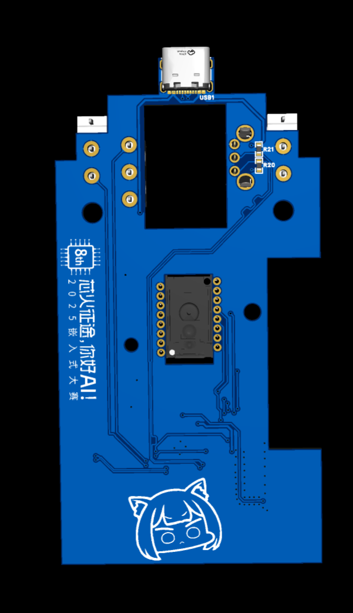
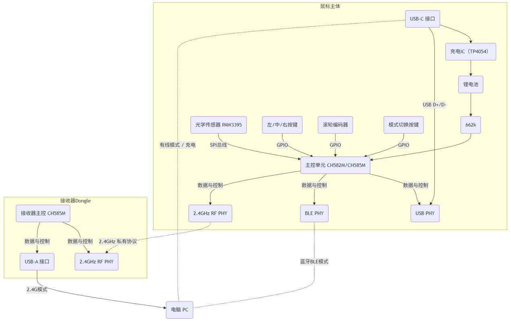
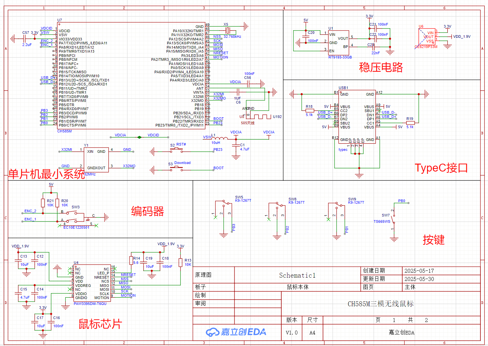
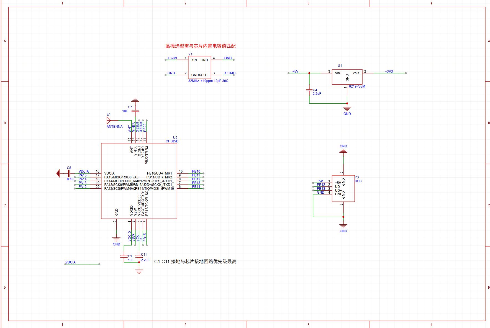
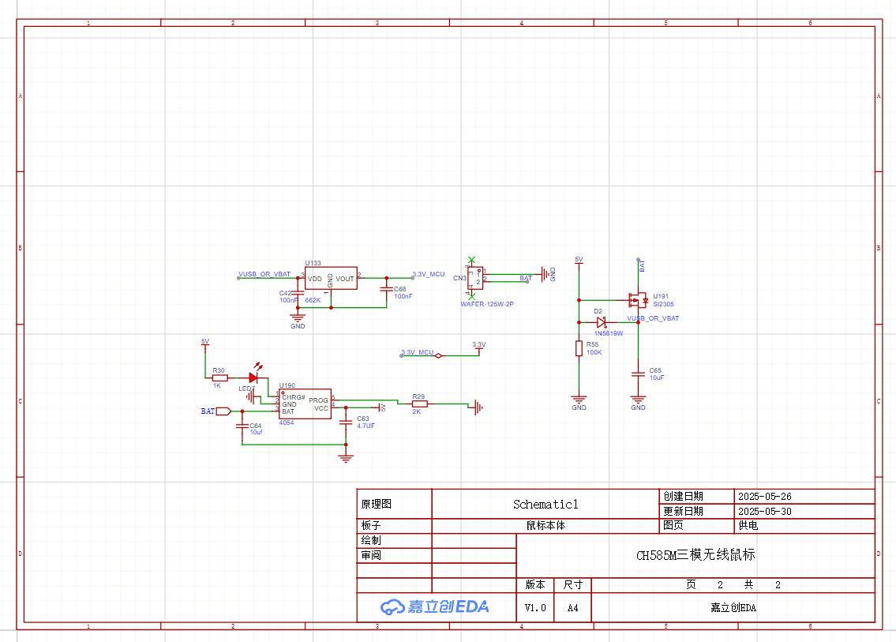
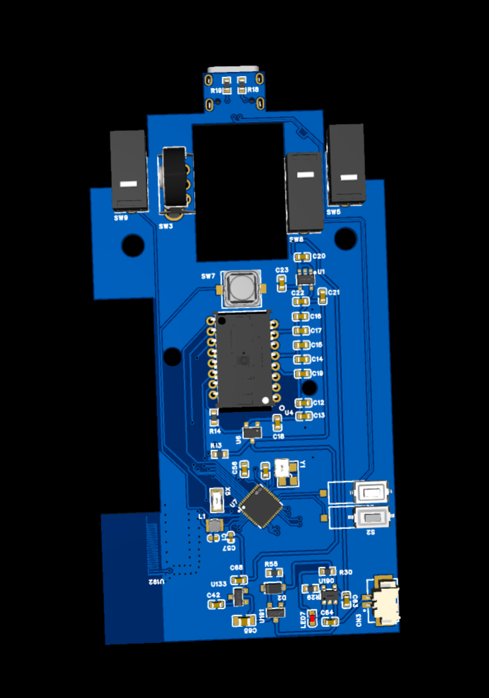
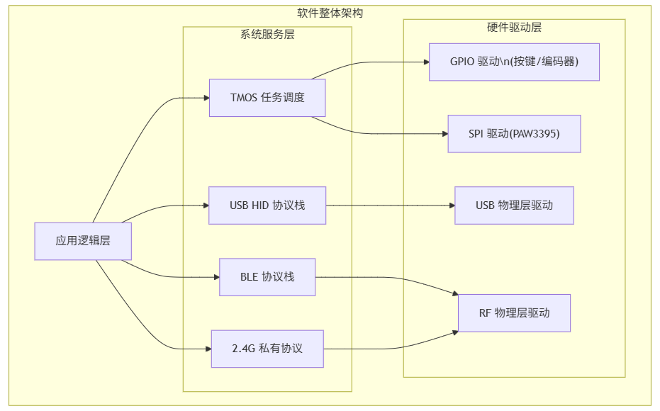
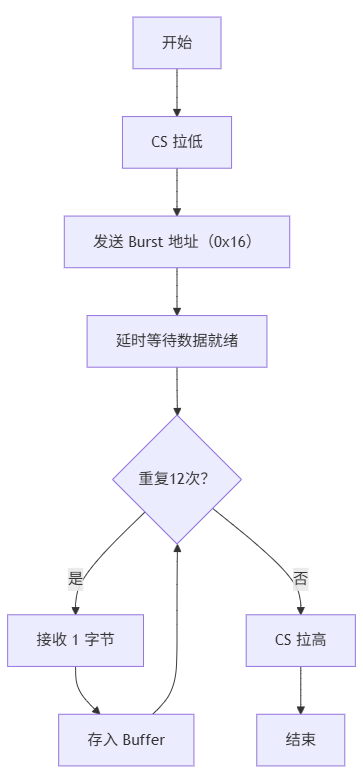
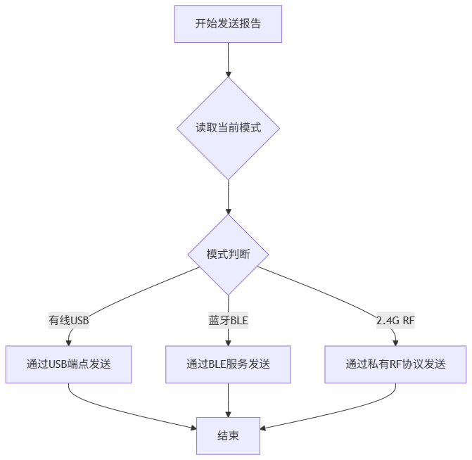
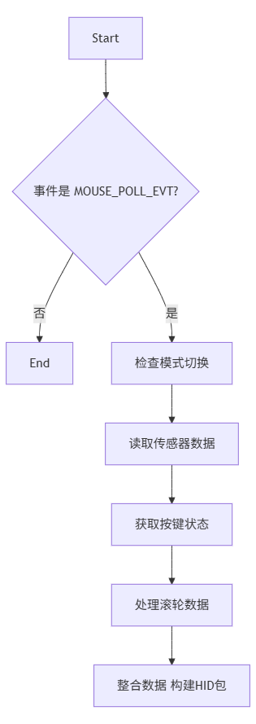

# 三模无线游戏鼠标 · Three-Mode Wireless Mouse (CH585M)

> 一颗 **沁恒 CH585M**（RISC-V）单芯片搞定有线 USB / 2.4G 私有协议 / 蓝牙 BLE 三种连接，
> 搭配原相 **PAW3395** 光学传感器，目标是电竞级的低延迟与高回报率。




*主板与 2.4G 接收器的 PCB 3D 预览（立创 EDA 导出）*

---

## 目录

- [1. 项目简介](#1-项目简介)
- [2. 系统方案](#2-系统方案)
- [3. 硬件设计](#3-硬件设计)
- [4. 固件设计](#4-固件设计)
- [5. 数据流与流程图](#5-数据流与流程图)
- [6. 仓库结构](#6-仓库结构)
- [7. 编译与烧录](#7-编译与烧录)
- [8. 性能指标](#8-性能指标)
- [9. 开源整理说明与已知问题](#9-开源整理说明与已知问题)
- [10. 来源、致谢与许可证](#10-来源致谢与许可证)

## 1. 项目简介

市面上的三模鼠标大多用"主控 + 独立蓝牙芯片 + 2.4G 芯片"多芯片方案，成本与面积都下不来。CH585M 把 USB 2.0 全速控制器、BLE 5.3 和 2.4 GHz 私有 RF 收发器集成在一颗 RISC-V MCU 里，因此整个鼠标只需要**一颗主控**就能覆盖三种连接方式。

本项目的目标：

| 目标 | 方案 |
| --- | --- |
| 三种连接方式 | 有线 USB HID / 2.4G 私有协议（配 Dongle）/ BLE HID |
| 高精度追踪 | PAW3395，最高 26000 DPI，SPI 24 MHz 读取 |
| 低延迟 | USB 中断端点 + 自定义报告描述符，1 ms 级上报 |
| 长续航 | 800 mAh 锂电池 + TP4054 充电 + FS312F 保护 |
| 免驱 | 三种模式都走标准 HID，插入即用 |

配套还做了基于同款 CH585M 的 **2.4G USB 接收器（Dongle）**，把无线数据转成 USB HID 报给电脑。

## 2. 系统方案



- **主控**：CH585M（RISC-V，片上 USB/BLE/2.4G），32 MHz 无源晶振；
- **传感器**：PAW3395 通过 SPI（Mode 0，24 MHz）与主控通信，`MOTION` 引脚可做移动唤醒；
- **电源**：USB-C 5 V → TP4054 线性充电 → 800 mAh 锂电池 → FS312F 保护 + 双 MOS → 拨动开关 → 662K LDO 3.3 V；
- **输入**：左右中微动 + EC10E1220501 机械编码器 + 模式切换按键；
- **接收器**：CH585M + π 型匹配网络 + 2.4G 陶瓷天线 + USB-A 插头，PB4 驱动状态灯。

## 3. 硬件设计



| 模块 | 器件 | 要点 |
| --- | --- | --- |
| 主控 | CH585M | 32 MHz 晶振（Y1）+ 22 pF 负载电容；VDD33/VSW/VDCID 就近去耦；复位键 S2、Boot 键 S3 |
| 传感器 | PAW3395DM-T6QU | 多路电源独立去耦；透镜与底壳开孔对位，保证 LOD 与平面度 |
| 充电 | TP4054 | 涓流/恒流/恒压三段式，USB-C 供电 |
| 电池保护 | FS312F-G + 双 MOS | 过充、过放、过流/短路保护 |
| 稳压 | 662K LDO | 3.3 V 给 MCU 与传感器 |
| 滚轮 | EC10E1220501 编码器 | 段落感清晰；与中键微动分离，互不干扰 |
| 接收器 RF | π 型匹配（C5/L1/C4）+ 陶瓷天线 | 阻抗匹配决定灵敏度和通信距离 |

| 主控电路 | 接收器电路 |
| --- | --- |
|  |  |

- 完整原理图 PDF：[`hardware/schematic/`](hardware/schematic)
- 立创 EDA 工程（可直接打开继续改）：[`hardware/easyeda/`](hardware/easyeda)
- PCB 3D 预览：[`docs/images/pcb-3d-render-front.png`](docs/images/pcb-3d-render-front.png)

| PCB 正面（3D） | PCB 背面（3D） |
| --- | --- |
|  |  |

## 4. 固件设计

### 4.1 架构



基于沁恒官方 **TMOS** 事件驱动调度，分三层：

- **驱动层**：SPI（PAW3395）、GPIO（按键/编码器）、USB 寄存器、RF 收发；
- **服务层**：TMOS 调度、USB HID 协议栈、BLE GATT/GAP、2.4G 私有协议；
- **应用层**：按键扫描、传感器读取、模式切换、报告分发。

代码清单（[`firmware/ch585-hid/`](firmware/ch585-hid)）：

| 文件 | 作用 |
| --- | --- |
| `hidmouse_main.c` | 初始化：HSE + PLL 到 62.4 MHz、USB 设备初始化、BLE 与 HID 服务注册、`TMOS_SystemProcess()` 主循环、USB 中断服务 |
| `hidmouse.c` | 应用主体：PAW3395 驱动、模式切换、报告组包与三路分发、电池电量服务 |
| `hidmouse.h` | 报告结构体、HID 服务回调声明 |

### 4.2 传感器驱动

- SPI0 主机，Mode 0，**24 MHz**，片选 `PA12`；
- 写寄存器：`address | 0x80`，随后写数据；读寄存器：`address & 0x7F` + 1 字节 dummy；
- 上电初始化写入约 100 条寄存器（`0x7F` 切页），覆盖 DPI、静默高度、采样率等；
- 周期读取 **Motion Burst**：一次连读 12 字节，X/Y 位移在 `data[2..5]`：

```c
myMouseReport.x = (int16_t)((motion_burst_data[3] << 8) | motion_burst_data[2]);
myMouseReport.y = (int16_t)((motion_burst_data[5] << 8) | motion_burst_data[4]);
```

- 按键：`PB1` 左键、`PB3` 右键、`PB2` 中键，低电平有效，上拉输入。

### 4.3 三模切换

模式切换键在 `PB23`，每按一次循环切换（带 10 ms 消抖）：

```c
typedef enum { MODE_BLUETOOTH, MODE_2_4G_RF, MODE_WIRED_USB, MODE_COUNT } work_mode_t;

current_mode = (work_mode_t)(((int)current_mode + 1) % MODE_COUNT);
apply_current_mode();   // 关 RF / 开 BLE 广播 / 初始化 2.4G
```

上电默认模式由 USB 上拉状态决定：`R8_USB_CTRL & RB_UC_DEV_PU_EN` 有效则进有线模式，否则进 2.4G 模式。

### 4.4 一份报告，三路分发

```c
static void hidEmuSendMouseReport(struct mouseHID_t* report)
{
    switch(current_mode) {
        case MODE_WIRED_USB:      // 直接写 USB EP1 缓冲并置 ACK
            memcpy(Ep1Buffer, (uint8_t*)report, sizeof(struct mouseHID_t));
            R8_UEP1_T_LEN = sizeof(struct mouseHID_t);
            R8_UEP1_CTRL = (R8_UEP1_CTRL & ~MASK_UEP_T_RES) | UEP_T_RES_ACK;
            break;
        case MODE_BLUETOOTH:      // 走 HID over GATT 通知
            HidDev_Report(HID_RPT_ID_MOUSE_IN, HID_REPORT_TYPE_INPUT,
                          sizeof(struct mouseHID_t), (uint8_t*)report);
            break;
        case MODE_2_4G_RF:        // 走私有 RF 单包发送
            RF_Tx((uint8_t*)report, sizeof(struct mouseHID_t), 0, 0);
            break;
    }
}
```

### 4.5 2.4G 私有协议参数

| 参数 | 值 |
| --- | --- |
| 接入地址 | `0x17263544` |
| 信道 | 10 |
| CRC 初值 | `0x555555` |
| 发送功率 | 0 dBm |
| 链路模式 | `LLE_MODE_AUTO`（自动应答 + 重传） |

### 4.6 BLE 部分

- 设备名 `HID Mouse`，广播包含 HID 服务与电池服务 UUID；
- 连接间隔请求 8（单位 1.25 ms）；
- 断连后自动重新开启广播。

## 5. 数据流与流程图

| 主流程 | 报告分发 | 上报路径 |
| --- | --- | --- |
|  |  |  |

## 6. 仓库结构

```
three-mode-wireless-mouse/
├── README.md
├── LICENSE
├── docs/
│   ├── 01-design.md            # 参赛设计报告整理（系统组成、软硬件细节）
│   └── images/                 # 系统框图、原理图、流程图、PCB 3D 预览
├── firmware/
│   ├── README.md
│   └── ch585-hid/              # CH585M 应用层（TMOS + HID + 三模切换）
│       ├── hidmouse_main.c
│       ├── hidmouse.c
│       └── hidmouse.h
└── hardware/
    ├── schematic/              # 原理图 PDF（鼠标主板 + 接收器）
    └── easyeda/                # 立创 EDA 专业版工程（.epro2）
```

## 7. 编译与烧录

仓库只包含**应用层代码**，编译需要沁恒的官方 SDK：

1. 安装 **MounRiver Studio**（MRS）与 WCH CH585/CH584 的 SDK（`CH58x_BLE_LIB`、`StdPeriphDriver`、USB 驱动、`HidDev`/`Batt` 服务）；
2. 新建或导入 CH585 的 HID 鼠标工程，把 `firmware/ch585-hid/` 的三个文件放进 `APP/` 目录（覆盖同名文件）；
3. 补上 `PAW3395.h` 的寄存器宏（`PAW3395_SPIREGISTER_MotionBurst` 等）与 `usb_handler.c` / `usb_descriptors.c`（自定义报告描述符，见原工程）；
4. 编译下载：USB 或 WCH-LinkE 烧录，首次下载需按住 Boot 键上电进入 ISP。

> 4. 里的 `usb_handler.c` 与 `PAW3395` 驱动头是参赛工程的一部分，本仓库没有随附完整工程，因此**不能开箱直接编译**，请按上面步骤接入官方 SDK。

## 8. 性能指标

| 指标 | 设计目标 / 报告值 |
| --- | --- |
| 连接方式 | 有线 USB / 2.4G / BLE 三模 |
| 回报率 | 有线与 2.4G 目标 2 kHz（见下方说明） |
| 传感器 | PAW3395，最高 26000 DPI |
| 电池 | 800 mAh，Type-C 充电 |
| 模式切换 | 按键循环切换，掉线自动回广播 |

> **口径说明**：设计报告摘要与"特性成果"写的是 2 kHz；同一份报告的"软件成果"一节又出现 8 kHz（USB）/ 4 kHz（2.4G）的表述。仓库里的固件是参赛提交版的应用层节选，轮询周期由 TMOS 事件间隔（`tmos_start_task(..., MOUSE_POLL_EVT, 8)`）决定，因此**实际回报率请以完整工程在 MouseTester 下的实测为准**，本 README 不替它下结论。

## 9. 开源整理说明与已知问题

整理时的处理：

1. 源码原为 GBK 编码，已统一转成 UTF-8，仅改编码不改内容；
2. 剔除参赛材料里的第三方教程 PDF（沁恒 USB 培训讲义）、PAW3395 数据手册、以及早期 STM32 原型（第三方开源项目，见第 10 节）；
3. `PAW3395.c` 在提交材料里是空文件，驱动实现实际位于 `hidmouse.c` 内（`PAW3395_Write_Register` / `PAW3395_Motion_Burst` 等），因此没有单独的驱动文件。

**已知缺失 / 待完善**

- 滚轮编码器尚未接入：代码里 `myMouseReport.wheel = 0;` 并留有 `// 此处应添加滚轮处理逻辑`；
- 电池电量服务只调用了 `Batt_MeasLevel()`，电量上报的阈值与低电告警策略未实现；
- 2.4G 一键配对（固定 ID 配对、跳频表）在节选代码中没有体现，`RF_2G4StatusCallBack` 为空实现；
- DPI 切换、LED 指示等鼠标常规功能不在这一版节选中。

## 10. 来源、致谢与许可证

- **本仓库内容**：参赛作品的硬件原理图/PCB 工程、应用层固件节选与设计报告，以 MIT 协议发布（见 [LICENSE](LICENSE)）。
- **第三方**：
  - 沁恒 CH585 的 BLE/HAL/USB 驱动与 `HidDev`/`Batt` 服务（WCH 官方 SDK，遵循其 Apache-2.0 许可）；
  - 原相 PAW3395 数据手册与寄存器定义（PixArt）；
  - 开发早期参考过 STM32F103 + PAW3395 的开源方案 [Li-Dongze/stm32_paw3395_mouse](https://github.com/Li-Dongze/stm32_paw3395_mouse)（立创开源广场同步发布），该原型代码**未**包含在本仓库中，如需请到原仓库获取并遵守其许可。
- 原理图由立创 EDA 专业版绘制，工程文件为 `.epro2`，请用立创 EDA 专业版打开。

如果这个工程对你有帮助，欢迎 Star ⭐；对三模切换或私有 2.4G 协议有更好的做法，欢迎开 Issue 讨论。
